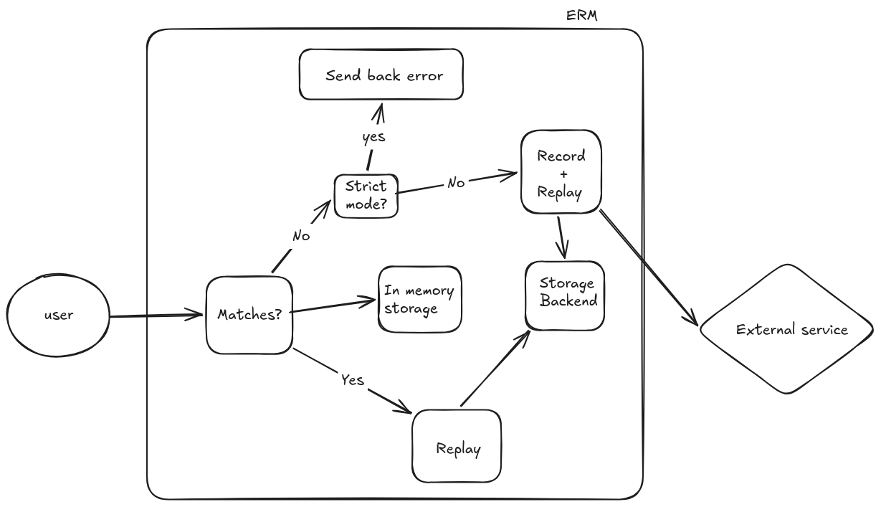

# ERM

# Introduction and Goals
This document describes ERM (Enregistrer, Rejouer, Modifier), a record and
replay HTTP server. ERM provides a simple way to mock complex or stochastic
requests into repeatable and exact responses.

The goal is to offer developpers a solid and correct platform for simplifying
complex testing with a record and replay workflow. It acts as a proxy while
recording new requests and avoid sending any request if the incoming request
matches a recorded fixture.

See example workflow

## Requirements Overview
Current implementation of record and replay mock servers tend to support only a
small subset of possible http requests, mostly with JSON bodies. These servers
tend to require heavy configuration or complex sequence of requests to be
operational. Our main requirements are:
| Requirement                                    | Type                       |
|------------------------------------------------|----------------------------|
| Customize by headers                           | Functional requirement     |
| Exact replay, down to the tens of milliseconds | Non functional requirement |
| High configurability                           | Non functional requirement |
| Human editable mocks                           | Functional requirement     |
| Save data on a storage backend                 | Functional requirement     |
| CLI                                            | Functional requirement     |
| Record any HTTP request                        | Functional requirement     |
| Match an HTTP request                          | Functional requirement     |
| Fail if no mock is matched (strict mode)       | Functional requirement     |
| Hot reload of mocks in storage backend         | Functional requirement     |

## Quality Goals
Here are the main quality goals:
1. Correctness: We need to be correct when replaying and registering the mocks. Modifications of the requests could be problematic for our users.
2. Performance: We need to imitate a real request-response workflow to show timeouts and latency problems.
3. Flexibility: We need to be flexible to support many different types of workflows.

## Stakeholders

| Role/Name    | Contact                   | Expectations                |
|--------------|---------------------------|-----------------------------|
| Simon Théorêt| simon.theoret99@gmail.com | Simply mock complex requests|

# Architecture Constraints

| Constraint                               | Background and / or motivation                    |
|------------------------------------------|---------------------------------------------------|
| Human editable data serialization format | Users must be able to edit their mocks, if needed |
| Must support HTTP and HTTPS              |                                                   |
| Portable on the three major OS           |                                                   |
| Fast implementation                      | Based on our requirements                         |

# Context and Scope

## Technical Context

ERM acts as a http proxy. It can send http(s) requests to any web server available locally or on the internet.

# Solution Strategy

# Building Block View

## Whitebox Overall System

***\<Overview Diagram\>***

Motivation

:   *\<text explanation\>*

Contained Building Blocks

:   *\<Description of contained building block (black boxes)\>*

Important Interfaces

:   *\<Description of important interfaces\>*

### \<Name black box 1\>

*\<Purpose/Responsibility\>*

*\<Interface(s)\>*

*\<(Optional) Quality/Performance Characteristics\>*

*\<(Optional) Directory/File Location\>*

*\<(Optional) Fulfilled Requirements\>*

*\<(optional) Open Issues/Problems/Risks\>*

### \<Name black box 2\>

*\<black box template\>*

### \<Name black box n\>

*\<black box template\>*

### \<Name interface 1\>

...​

### \<Name interface m\>

## Level 2

### White Box *\<building block 1\>*

*\<white box template\>*

### White Box *\<building block 2\>*

*\<white box template\>*

...​

### White Box *\<building block m\>*

*\<white box template\>*

## Level 3

### White Box \<\_building block x.1\_\>

*\<white box template\>*

### White Box \<\_building block x.2\_\>

*\<white box template\>*

### White Box \<\_building block y.1\_\>

*\<white box template\>*

# Runtime View

## \<Runtime Scenario 1\>

- *\<insert runtime diagram or textual description of the scenario\>*

- *\<insert description of the notable aspects of the interactions
  between the building block instances depicted in this diagram.\>*

## \<Runtime Scenario 2\>

## ...​

## \<Runtime Scenario n\>

# Deployment View

## Infrastructure Level 1

***\<Overview Diagram\>***

Motivation

:   *\<explanation in text form\>*

Quality and/or Performance Features

:   *\<explanation in text form\>*

Mapping of Building Blocks to Infrastructure

:   *\<description of the mapping\>*

## Infrastructure Level 2

### *\<Infrastructure Element 1\>*

*\<diagram + explanation\>*

### *\<Infrastructure Element 2\>*

*\<diagram + explanation\>*

...​

### *\<Infrastructure Element n\>*

*\<diagram + explanation\>*

# Cross-cutting Concepts

## *\<Concept 1\>*

*\<explanation\>*

## *\<Concept 2\>*

*\<explanation\>*

...​

## *\<Concept n\>*

*\<explanation\>*

# Architecture Decisions

# Quality Requirements

## Quality Requirements Overview

## Quality Scenarios

# Risks and Technical Debts

# Glossary

+----------------------+-----------------------------------------------+
| Term                 | Definition                                    |
+======================+===============================================+
| *\<Term-1\>*         | *\<definition-1\>*                            |
+----------------------+-----------------------------------------------+
| *\<Term-2\>*         | *\<definition-2\>*                            |
+----------------------+-----------------------------------------------+
