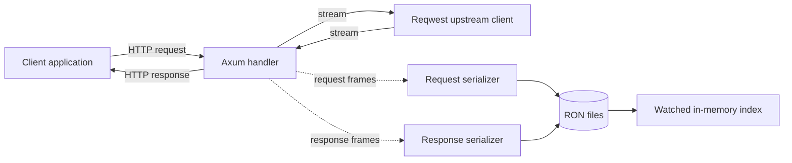
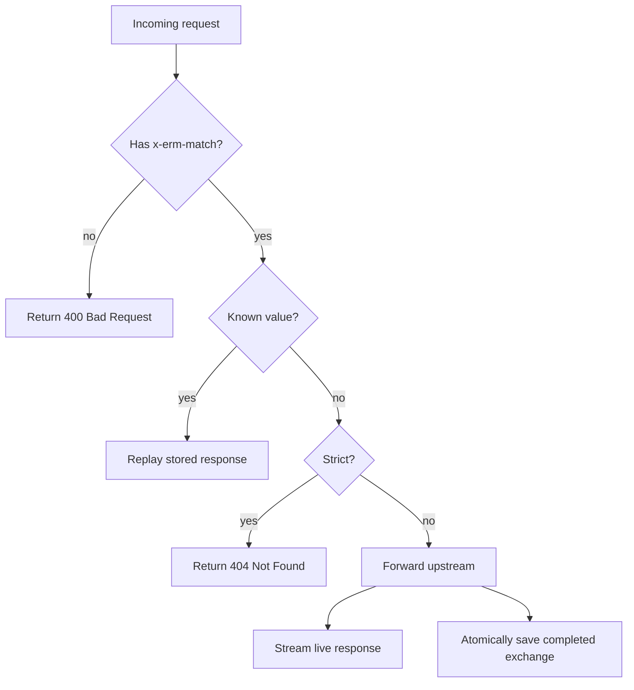

# ERM Design

## Status

This is a living design document. It separates observed behavior in the current code from proposed product boundaries. Items marked **Open** require a project decision before they should be treated as requirements.

## Problem and Goal

HTTP dependencies are often slow, unreliable, expensive, or difficult to reproduce in tests. Conventional mocks work well for simple request/response APIs but commonly lose streaming behavior, unusual headers, binary bodies, and response timing.

ERM is a record/replay proxy for local development, automated tests, and CI/CD. It captures real HTTP exchanges once and replays them deterministically from human-inspectable files. The intended experience is:

1. Point an application at ERM instead of an upstream service.
2. Let ERM replay requests it recognizes.
3. Let ERM forward and record requests it does not recognize.
4. Inspect, edit, and version selected recordings.
5. Enable strict behavior in CI so unexpected requests fail instead of reaching the upstream.

The project favors operational simplicity, faithful streaming, and editable artifacts over a large configuration surface.

## Scope and Boundaries

### Intended capabilities

- Ship as one Rust binary, also buildable as a container image.
- Run in developer and test environments, including CI/CD pipelines.
- Proxy HTTP requests to an HTTP or HTTPS destination.
- Record request and response metadata, body frames, and inter-frame delays.
- Persist recordings as RON files and notice edits without restarting.
- Match an incoming `x-erm-match` value to a recorded exchange and stream the stored response.
- Make match misses and malformed recordings diagnosable.
- Can match any request

### Provisional non-goals

These boundaries define what ERM is not intended to become:

- Serving production traffic or acting as a production API gateway, reverse-proxy fleet, or load-testing system.
- Intercepting arbitrary HTTPS traffic through certificate-based MITM.
- Providing distributed storage or multi-process coordination.
- Preserving transport-level details below HTTP body frames.
- Supporting an unrestricted matching language in the first release.

## Current Architecture

The implemented path is recording-only:

`src/main.rs` owns application startup and request forwarding. Each exchange receives a UUIDv7. Request and response streams are tee'd into unbounded channels so forwarding can continue while background tasks collect frames. When a stream ends, the corresponding task writes `request_<id>.ron` or `response_<id>.ron`.

`src/ir.rs` defines serializable wrappers for HTTP methods, versions, URIs, URLs, headers, status codes, and timed body frames. Request and response files are paired by UUID rather than stored atomically as one record.

`src/storage.rs` loads RON files into an in-memory map and watches the mock directory. Filesystem events are applied lazily when `mocks()` is called. `src/matching.rs` can select a request by `x-erm-match` and locate its paired response, but this function is not connected to the HTTP handler. There is not yet a stored-response replay stream.

## Target Request Flow

The default is a hybrid **record/replay** mode. A strict option changes only the behavior of a match miss:

- **Validate:** require exactly one usable `x-erm-match` value. A missing or invalid value returns `400 Bad Request` in both default and strict operation; ERM must not contact the upstream or create a recording.
- **Match:** snapshot the current mock index and look up the incoming `x-erm-match` value.
- **Replay:** reproduce the stored status, headers, body-frame order, and optionally timing without contacting the upstream.
- **Record fallback:** when a match key is present but unknown, forward upstream, stream the live response to the caller, and persist the completed exchange.
- **Strict miss:** when no match exists, do not contact the upstream; return `404 Not Found` with a diagnostic body. This makes undeclared dependencies visible in CI/CD.

Strict selection and timing controls belong at the application boundary. Serialization, storage, and matching should remain independently testable. Request handling must not hold the storage mutex while streaming or performing network I/O.

## Recording Format

Each completed request/response pair should be stored in one versioned `exchange_<id>.ron` file. The top-level record contains a schema version, exchange ID, request, and response. Writers should serialize to a temporary file in the mock directory and rename it into place only after both streams complete. This prevents the watcher from loading a half-written exchange and makes pairing atomic. Recordings interrupted before completion may be discarded initially; preserving partial exchanges is not a requirement.

## Design Invariants

- Each file contains exactly one request and its response under the same stable ID.
- Every recorded exchange has a non-empty `x-erm-match` value.
- Body bytes and frame order survive a serialize/deserialize round trip.
- Repeated headers remain repeated; recording must not silently collapse values such as `set-cookie`.
- Slow recording I/O should not delay the proxied response under normal load.
- A malformed or partially written recording must produce a controlled error, not terminate unrelated requests.
- When several mocks match, selection must be deterministic and documented.

## Known Limits of the Current Implementation

- Replay and matching are not wired into request handling.
- Body capture uses unbounded channels and buffers complete exchanges before writing, so memory is unbounded.
- Serializer task failures are detached and not surfaced.
- Bad RON can fail startup or panic request handling.
- Request and response are written as separate, non-atomic files and can be incomplete or unpaired.
- Deleted files may remain in the in-memory index because removal checks require the path to exist.
- Matching among duplicate header values depends on `HashMap` iteration order.
- The server exposes plain HTTP only and has no authentication or access control.

## Open Decisions

1. **Strict interface:** should strictness be a `--strict` flag, a subcommand, or configuration? What diagnostic response body should a miss contain?
2. **Validation response:** what diagnostic response body should a missing or invalid `x-erm-match` value contain?
3. **Duplicate keys:** should loading reject duplicate `x-erm-match` values, or should a documented ordering rule select one?
4. **Timing:** reproduce recorded delays by default, make them optional, or allow a speed multiplier?
5. **Format compatibility:** what migration policy applies when the exchange schema version changes?
6. **Safety limits:** what maximum body size, frame count, delay, and concurrent recording count should be enforced?

## Confirmed Decisions

- ERM uses hybrid record/replay behavior by default.
- ERM is intended for development, testing, and CI/CD—not production proxying.
- Strict behavior returns an error on a match miss and never falls through to the upstream.
- Initial matching remains based on the user-provided `x-erm-match` header.
- A missing `x-erm-match` header is always an error and is never proxied or recorded.
- A missing or invalid match header returns `400 Bad Request`; an unknown key in strict mode returns `404 Not Found`.
- A completed exchange is persisted as one atomic, versioned file rather than separate request and response files.
- The destination path prefixes the incoming path, and the incoming query is preserved.
- ERM removes hop-by-hop headers at each network boundary while retaining the decoded input headers in recordings.

## Suggested Delivery Order

First, decide forwarding semantics, the strict CLI interface, and duplicate-key behavior. Next, introduce the versioned exchange type and atomic persistence while fixing repeated headers, deletion, bounded capture, and error handling. Then connect deterministic matching and replay to the handler. Finally, add end-to-end tests covering record fallback, edit/reload, replay, strict misses, and streaming timing.
